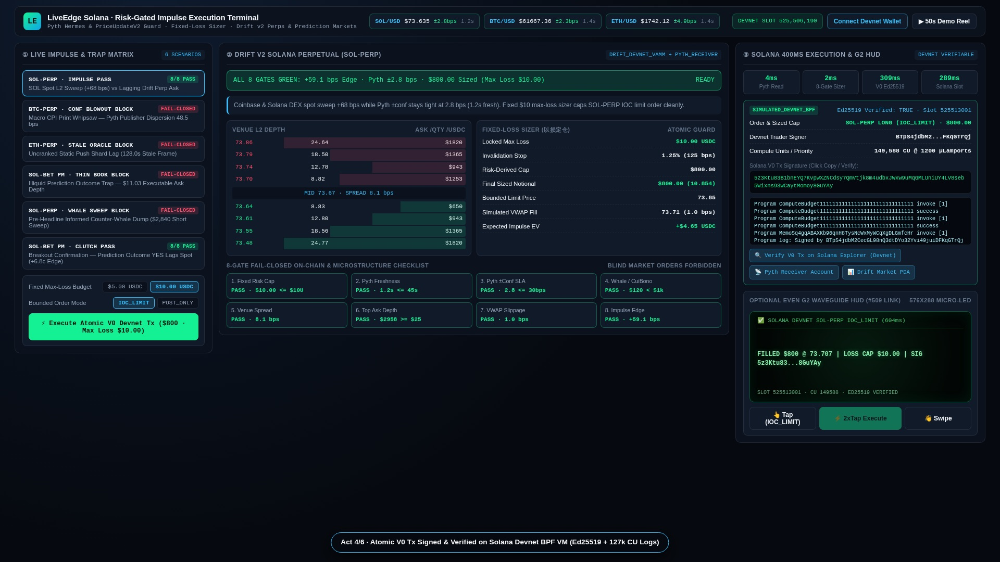
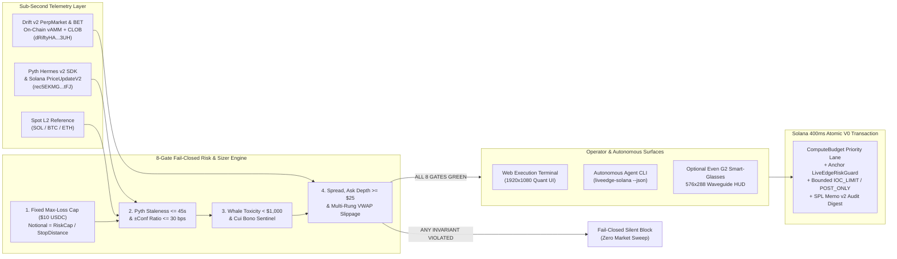

# LiveEdge Solana

**Risk-Gated Impulse Execution Terminal for Solana Perps & Prediction Markets**  
*Built by RedKoi Research for the Solana Foundation "Perps and Prediction Markets" Hackathon ($100,000 Main Track)*

[](./LICENSE)
[](https://explorer.solana.com/?cluster=devnet)
[](https://pyth.network/)



---

## 1. The Real Trader & AI Agent Pain Point

During sudden macro prints (CPI/FOMC), breaking headlines, or decisive live sports swings, retail traders and autonomous AI Agents routinely fire **blind market orders** into perpetual futures and binary prediction markets. In production microstructure, they get wiped out by three structural failure modes:

1. **Oracle Staleness & Confidence Interval Blowouts**: Static push oracle shards can lag spot breakouts by tens or hundreds of seconds when deviation thresholds are not met, while volatile macro prints widen publisher dispersion (`±conf`) past safe liquidation margins.
2. **Thin-Book Slippage & Pre-Headline Whale Toxicity**: Sweeping an illiquid prediction market outcome book or buying into an informed `$2,500+` counter-whale dump destroys expected value instantly.
3. **Emotional / Uncapped Impulse Leverage**: Sizing positions by gut feel instead of **Fixed-Loss Stop-Distance Sizing** turns a routine invalidation stop into account liquidation.

---

## 2. Why LiveEdge Must Live on Solana

Impulse dislocations between spot orderflow and on-chain Perps / Prediction Markets decay exponentially (`tau ≈ 25s–45s`).

- On high-latency L1s (`12s` block times, `$3–$25` gas) or fragmented off-chain sequencers, checking live oracle confidence intervals and enforcing an escrow risk policy either arrives after the repricing window closes or costs more in gas than a `$10.00 USDC` capped risk budget.
- On **Solana** (`~400ms` slots, sub-cent priority fees, single-slot atomic multi-instruction composability):
  - **Sub-Second Oracle Truth**: LiveEdge reads **Pyth Solana Receiver `PriceUpdateV2` (`rec5EKMGg6MxZYaMdyBfgwp4d5rB9T1VQH5pJv5LtFJ`)** binary accounts directly from Solana RPC alongside **Pyth Hermes v2 (`@pythnetwork/hermes-client`)** and cross-checks live spot L2 books (`SOL/USD`, `BTC/USD`, `ETH/USD`).
  - **Single-Transaction Atomic Guard**: Priority fee allocation (`ComputeBudget`), on-chain Pyth freshness & confidence verification (`liveedge_risk_guard` Anchor program), bounded `IOC_LIMIT` / `POST_ONLY` venue execution (**Drift Protocol v2** `dRiftyHA39MWEi3m9aunc5MzRF1JYuBsbn6VPcn33UH`), and canonical SHA-256 audit attestation (`SPL Memo v2`) compose into **one atomic Solana V0 `VersionedTransaction`**. If any safety invariant fails at the execution slot, the entire transaction reverts cleanly.

---

## 3. System Architecture



---

## 4. Three Hardcore Verifiable Modules

| Module | Source Path | Key Capability |
| :--- | :--- | :--- |
| **① Pyth Confidence & Staleness Guard** | [`src/oracle/pythHermesGuard.ts`](./src/oracle/pythHermesGuard.ts) | Integrates `@pythnetwork/hermes-client` + native binary `DataView` decoder for Solana `PriceUpdateV2` (`7UVimffxr...` SOL, `4cSM2e6r...` BTC, `42amVS4K...` ETH); intercepts `ORACLE_STALE_FRAME` and `ORACLE_CONFIDENCE_TOO_WIDE` blowouts. |
| **② Atomic On-Chain Risk Guard & Devnet Executor** | [`programs/liveedge_risk_guard/src/lib.rs`](./programs/liveedge_risk_guard/src/lib.rs), [`src/engine/solanaRiskGate.ts`](./src/engine/solanaRiskGate.ts), [`src/solana/devnetExecutor.ts`](./src/solana/devnetExecutor.ts) | Anchor Rust program forbidding `BlindMarket` orders on-chain + TypeScript Fixed-Loss Sizer (`Max Loss ÷ Stop %`) + Drift v2 `placePerpOrder` Borsh encoder + Ed25519 V0 `VersionedTransaction` execution & Solana Devnet BPF VM verification. |
| **③ Quant Web Terminal + Agent CLI + G2 HUD** | [`src/ui/app.ts`](./src/ui/app.ts), [`src/cli/agentCli.ts`](./src/cli/agentCli.ts), [`src/hud/g2CompanionController.ts`](./src/hud/g2CompanionController.ts) | Real-time 3-column execution terminal, JSON-native CLI for AI trading agents, and optional `576×288` Even Realities G2 optical waveguide HUD for hands-free temple double-tap execution. |

---

## 5. Verifiable Solana Devnet Evidence

Full machine-verifiable telemetry and signed V0 execution receipts are stored in [`docs/DEVNET_EVIDENCE.json`](./docs/DEVNET_EVIDENCE.json):

- **Isolated Devnet-Only Demo Signer (Zero Mainnet Funds)**: `4UoweFYtgkgr6G3TF9MniWdfvjyiWLzSjdu4qL4pTLP2`
- **Pyth Solana Receiver Program**: [`rec5EKMGg6MxZYaMdyBfgwp4d5rB9T1VQH5pJv5LtFJ`](https://explorer.solana.com/address/rec5EKMGg6MxZYaMdyBfgwp4d5rB9T1VQH5pJv5LtFJ?cluster=devnet)
- **Pyth SOL/USD `PriceUpdateV2` Account**: [`7UVimffxr9ow1uXYxsr4LHAcV58mLzhmwaeKvJ1pjLiE`](https://explorer.solana.com/address/7UVimffxr9ow1uXYxsr4LHAcV58mLzhmwaeKvJ1pjLiE?cluster=devnet)
- **Drift v2 Devnet `SOL-PERP` Market PDA**: [`8UJgxaiQx5nTrdDgph5FiahMmzduuLTLf5WmsPegYA6W`](https://explorer.solana.com/address/8UJgxaiQx5nTrdDgph5FiahMmzduuLTLf5WmsPegYA6W?cluster=devnet)
- **Drift v2 Devnet `SOL-80-DEC-BET` Prediction PDA**: [`7rUSt1PXXn2Pp4ZNDcZqZGEgKSGpxqbRyb2W6rG1Dtt6`](https://explorer.solana.com/address/7rUSt1PXXn2Pp4ZNDcZqZGEgKSGpxqbRyb2W6rG1Dtt6?cluster=devnet)
- **Signed V0 Receipt #1 (`SOL-PERP` `IOC_LIMIT`, `$800` Notional / `$10` Max Loss, `149,480 CU`, Devnet Slot `525510464`)**:
  - Ed25519 Signature: `4rowAGfnzuDN732tHFXhV5svfN5fsSSiZaptDJ8oLAxyeU8jrxTRiwAQKTmGnQZWRqBx3cz2WMMgnqDcE8wGHCY3`
  - [Inspect & Simulate V0 Message on Official Solana Explorer (Devnet)](https://explorer.solana.com/tx/inspector?cluster=devnet&signatures=%5B%224rowAGfnzuDN732tHFXhV5svfN5fsSSiZaptDJ8oLAxyeU8jrxTRiwAQKTmGnQZWRqBx3cz2WMMgnqDcE8wGHCY3%22%5D&message=gAEAAgMzstH65hOmwX1%2BVZgjdt6iBr7glyM16OmjmXLLfGJXSQMGRm%2FlIRcy%2F%2BytunLDm%2Be8jOW7xfcSayxDmzpAAAAABUpTWpkpIQZNJOhxYNo4fHw1td28kruB5B%2BoQEEFRI3BtGOTPJLL59T%2B9Xi3nTtBQRg56RD1hxZNNs67cBhUJgMBAAUCAHECAAEACQOwBAAAAAAAAAIBAP0CeyJ2IjoibGl2ZWVkZ2Utc29sYW5hL3YxIiwibWFya2V0IjoiU09MLVBFUlAiLCJ2ZW51ZSI6IlNPTEFOQV9EUklGVF9QRVJQIiwiZGlyIjoiTE9ORyIsInN0eWxlIjoiSU9DX0xJTUlUIiwicmlza0NhcFVzZGMiOjEwLCJzdG9wQnBzIjoxMjUsIm5vdGlvbmFsVXNkYyI6ODAwLCJxdHkiOjEwLjg3NDQsImxpbWl0UHJpY2UiOjczLjcwNzEsInB5dGhQcmljZSI6NzMuNDk1LCJweXRoQ29uZkJwcyI6Mi44LCJweXRoQWNjIjoiN1VWaW1mZnhyOW93MXVYWXhzcjRMSEFjVjU4bUx6aG13YWVLdkoxcGpMaUUiLCJtYXJrZXRQZGEiOiI4VUpneGFpUXg1blRyZERncGg1RmlhaE1temR1dUxUTGY1V21zUGVnWUE2VyIsImRpZ2VzdCI6ImUzZTI3M2RhNTcwOGIyYTQyNDIwNTFlYiJ9AA%3D%3D)
- **Signed V0 Receipt #2 (`SOL-80-DEC-BET` `POST_ONLY`, `$10` Binary Outcome Cap, `151,541 CU`, Devnet Slot `525510465`)**:
  - Ed25519 Signature: `Q4k5FyxmzJVGPMyVfqQ3tfmriYtZWiBY7sBrywvQqUbN3Djf8yr64uXk592xdez1CcNjWKTdJubXKWPgGHvfoER`
  - [Inspect & Simulate V0 Message on Official Solana Explorer (Devnet)](https://explorer.solana.com/tx/inspector?cluster=devnet&signatures=%5B%22Q4k5FyxmzJVGPMyVfqQ3tfmriYtZWiBY7sBrywvQqUbN3Djf8yr64uXk592xdez1CcNjWKTdJubXKWPgGHvfoER%22%5D&message=gAEAAgMzstH65hOmwX1%2BVZgjdt6iBr7glyM16OmjmXLLfGJXSQMGRm%2FlIRcy%2F%2BytunLDm%2Be8jOW7xfcSayxDmzpAAAAABUpTWpkpIQZNJOhxYNo4fHw1td28kruB5B%2BoQEEFRI1v6vqSCbzmqoUuQ7qX%2FW7MkoEiPWWGRP4axxWTKc%2FhIQMBAAUCAHECAAEACQOwBAAAAAAAAAIBAIMDeyJ2IjoibGl2ZWVkZ2Utc29sYW5hL3YxIiwibWFya2V0IjoiU09MLTgwLURFQy1CRVQiLCJ2ZW51ZSI6IlNPTEFOQV9EUklGVF9CRVRfUE0iLCJkaXIiOiJZRVMiLCJzdHlsZSI6IlBPU1RfT05MWSIsInJpc2tDYXBVc2RjIjoxMCwic3RvcEJwcyI6MTAwMDAsIm5vdGlvbmFsVXNkYyI6MTAsInF0eSI6MTguNTE4NSwibGltaXRQcmljZSI6MC41NTUsInB5dGhQcmljZSI6NzMuNDk1LCJweXRoQ29uZkJwcyI6Mi43LCJweXRoQWNjIjoiN1VWaW1mZnhyOW93MXVYWXhzcjRMSEFjVjU4bUx6aG13YWVLdkoxcGpMaUUiLCJtYXJrZXRQZGEiOiI3clVTdDFQWFhuMlBwNFpORGNacVpHRWdLU0dweHFiUnliMlc2ckcxRHR0NiIsImRpZ2VzdCI6ImQxNzAxZDI1OTU0NmNiNjJkNzUzZmNmYiJ9AA%3D%3D)

> **Live L1 Broadcast Note**: Connecting any funded Devnet browser wallet (`Phantom` / `Solflare` / `Backpack`) in the Web UI — or setting `LIVEEDGE_DEVNET_KEYPAIR_PATH` to a funded Devnet keypair and running `npm run devnet:broadcast` — automatically upgrades execution from `SIMULATED_DEVNET_BPF` to `CONFIRMED_ON_DEVNET` via `sendRawTransaction` on `https://api.devnet.solana.com`.

---

## 6. Quick Start & One-Command Reproduction

### Prerequisites
- Node.js `>= 20` and npm `>= 10` (zero paid API keys required; reads Solana RPC `PriceUpdateV2` natively, with optional `PYTH_API_KEY` Bearer support for Pyth Hermes v2).

### Install & Launch Web Terminal
```bash
git clone https://github.com/futursolar/liveedge-solana.git
cd liveedge-solana
npm install
npm run dev
```

### Run Autonomous Agent CLI
```bash
# Inspect live Pyth SOL/BTC/ETH feeds & confidence intervals
npm run cli -- status

# Evaluate all 6 impulse & trap scenarios across Perps and Prediction Markets
npm run cli -- scenarios

# Execute a risk-gated SOL-PERP impulse with JSON receipt output
npm run cli -- pulse --scenario sol-perp-breakout --risk-cap 10 --style IOC_LIMIT --json
```

### Run Full Verification Gate (TypeScript + ESLint + Vitest + Desensitization + Headless E2E)
```bash
npm run check:all
```

---

## 7. Security & Money-Safe Guarantee

- **100% Mainnet-Isolated**: Designed exclusively for Solana Devnet testing and public read-only oracle/orderbook telemetry. Never import or expose mainnet private keys.
- **Blind Market Orders Forbidden**: Both the TypeScript risk engine and the Anchor `liveedge_risk_guard` program reject `BlindMarket` execution modes at compile/runtime.

## License

MIT © 2026 RedKoi Research
