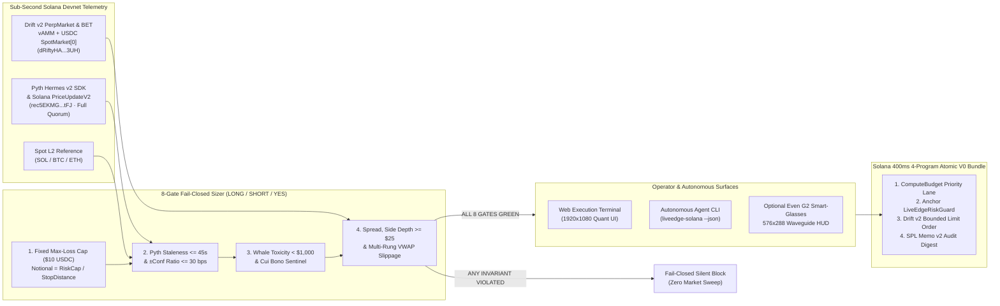

# LiveEdge Solana

**Risk-Gated Impulse Execution Terminal for Solana Perps & Prediction Markets**  
*Built by RedKoi Research for the Solana Foundation "Perps and Prediction Markets" Hackathon ($100,000 Main Track)*

[](./LICENSE)
[](https://explorer.solana.com/?cluster=devnet)
[](https://pyth.network/)


---

## 1. The Real Trader & AI Agent Pain Point

During sudden macro prints (CPI/FOMC), breaking headlines, or decisive live sports swings, retail traders and autonomous AI Agents routinely fire **blind market orders** into perpetual futures and binary prediction markets. In production microstructure, they get wiped out by three structural failure modes:

1. **Oracle Staleness & Confidence Interval Blowouts**: Static push oracle shards can lag spot breakouts by tens or hundreds of seconds when deviation thresholds are not met, while volatile macro prints widen publisher dispersion (`±conf`) past safe liquidation margins.
2. **Thin-Book Slippage & Pre-Headline Whale Toxicity**: Sweeping an illiquid prediction market outcome book or buying into an informed `$2,500+` counter-whale dump destroys expected value instantly.
3. **Emotional / Uncapped Impulse Leverage**: Sizing positions by gut feel instead of **Fixed-Loss Stop-Distance Sizing** turns a routine invalidation stop into account liquidation.

---

## 2. Why LiveEdge Must Live on Solana

Impulse dislocations between spot orderflow and on-chain Perps / Prediction Markets decay exponentially (`tau ≈ 25s–45s`).

- On high-latency L1s (`12s` block times, `$3–$25` gas) or fragmented off-chain sequencers, checking live oracle confidence intervals and enforcing an escrow risk policy either arrives after the repricing window closes or costs more in gas than a `$10.00 USDC` capped risk budget.
- On **Solana** (`~400ms` slots, sub-cent priority fees, single-slot atomic multi-instruction composability):
  - **Sub-Second Devnet & Mainnet Oracle Truth**: LiveEdge reads **Pyth Solana Receiver `PriceUpdateV2` (`rec5EKMGg6MxZYaMdyBfgwp4d5rB9T1VQH5pJv5LtFJ`)** binary accounts (`VerificationLevel::Full`) directly from Solana RPC alongside **Pyth Hermes v2 (`@pythnetwork/hermes-client`)** and live **Drift Protocol v2 (`dRiftyHA39MWEi3m9aunc5MzRF1JYuBsbn6VPcn33UH`)** `PerpMarket` vAMM reserves (`SOL-PERP`, `BTC-PERP`, `ETH-PERP`, and Devnet BET Prediction `#26`).
  - **4-Program Single-Transaction Atomic V0 Bundle**: Priority fee allocation (`ComputeBudget`), on-chain Pyth `VerificationLevel::Full` + `raw_price`-anchored slippage & fixed-loss guard (`liveedge_risk_guard` Anchor program), bounded `IOC_LIMIT` / `POST_ONLY` venue execution (`Drift v2::place_perp_order` with canonical `OracleMap` + `SpotMarket[0]` USDC margin + `PerpMarketMap` remaining accounts), and canonical SHA-256 audit attestation (`SPL Memo v2`) compose into **one atomic Solana V0 `VersionedTransaction`**.

---

## 3. System Architecture



---

## 4. Three Hardcore Verifiable Modules

| Module | Source Path | Key Capability |
| :--- | :--- | :--- |
| **① Pyth Confidence, Staleness & Quorum Guard** | [`src/oracle/pythHermesGuard.ts`](./src/oracle/pythHermesGuard.ts) | Integrates `@pythnetwork/hermes-client` + native binary `DataView` decoder for Solana Devnet `PriceUpdateV2` (`7UVimffxr...` SOL, `4cSM2e6r...` BTC, `42amVS4K...` ETH); enforces `VerificationLevel::Full` and blocks `ORACLE_STALE_FRAME` and `ORACLE_CONFIDENCE_TOO_WIDE` blowouts. |
| **② Atomic On-Chain Risk Guard & Devnet Executor** | [`programs/liveedge_risk_guard/src/lib.rs`](./programs/liveedge_risk_guard/src/lib.rs), [`src/engine/solanaRiskGate.ts`](./src/engine/solanaRiskGate.ts), [`src/solana/devnetExecutor.ts`](./src/solana/devnetExecutor.ts) | Cargo-tested Anchor `0.30.1` Rust program (`idl-build` verified) anchoring slippage directly to Pyth `raw_price`, verifying `DRIFT_V2_PROGRAM_ID` market ownership & forbidding `OrderMode::BlindMarket` orders + `e6` integer-aligned TypeScript `LONG`/`SHORT`/`YES` Fixed-Loss Sizer + 4-program V0 transaction builder & Agave `LiteSVM` (`sigVerify: true`) `SPL Memo v2` audit-envelope verifier. |
| **③ Quant Web Terminal + Agent CLI + G2 HUD** | [`src/ui/app.ts`](./src/ui/app.ts), [`src/cli/agentCli.ts`](./src/cli/agentCli.ts), [`src/hud/g2CompanionController.ts`](./src/hud/g2CompanionController.ts) | Real-time 3-column execution terminal, JSON-native CLI for AI trading agents, and optional `576×288` Even Realities G2 optical waveguide HUD for hands-free temple double-tap execution. |

---

## 5. Verifiable Solana Devnet & Agave LiteSVM Audit-Envelope Evidence

Full machine-verifiable Devnet telemetry, 4-program signed V0 bundles, and standalone 3-instruction Agave `LiteSVM` (`ComputeBudget` + `SPL Memo v2`) audit-envelope proofs are stored in [`docs/DEVNET_EVIDENCE.json`](./docs/DEVNET_EVIDENCE.json) (observed at Solana Devnet Slot `525547375`):

- **Isolated Devnet-Only Demo Signer (Zero Mainnet Funds)**: `4UoweFYtgkgr6G3TF9MniWdfvjyiWLzSjdu4qL4pTLP2`
- **Pyth Solana Receiver Program**: [`rec5EKMGg6MxZYaMdyBfgwp4d5rB9T1VQH5pJv5LtFJ`](https://explorer.solana.com/address/rec5EKMGg6MxZYaMdyBfgwp4d5rB9T1VQH5pJv5LtFJ?cluster=devnet)
- **Pyth Devnet `SOL/USD` `PriceUpdateV2` Account**: [`7UVimffxr9ow1uXYxsr4LHAcV58mLzhmwaeKvJ1pjLiE`](https://explorer.solana.com/address/7UVimffxr9ow1uXYxsr4LHAcV58mLzhmwaeKvJ1pjLiE?cluster=devnet) (`VerificationLevel::Full`, Devnet Slot `525534599`)
- **Drift v2 Devnet `SOL-PERP` Market PDA & Oracle**: [`8UJgxaiQx5nTrdDgph5FiahMmzduuLTLf5WmsPegYA6W`](https://explorer.solana.com/address/8UJgxaiQx5nTrdDgph5FiahMmzduuLTLf5WmsPegYA6W?cluster=devnet) · Oracle [`3m6i4RFWEDw2Ft4tFHPJtYgmpPe21k56M3FHeWYrgGBz`](https://explorer.solana.com/address/3m6i4RFWEDw2Ft4tFHPJtYgmpPe21k56M3FHeWYrgGBz?cluster=devnet) · USDC `SpotMarket[0]` [`6gMq3mRCKf8aP3ttTyYhuijVZ2LGi14oDsBbkgubfLB3`](https://explorer.solana.com/address/6gMq3mRCKf8aP3ttTyYhuijVZ2LGi14oDsBbkgubfLB3?cluster=devnet)
- **Drift v2 Devnet `SOL-80-DEC-BET` Prediction PDA**: [`7rUSt1PXXn2Pp4ZNDcZqZGEgKSGpxqbRyb2W6rG1Dtt6`](https://explorer.solana.com/address/7rUSt1PXXn2Pp4ZNDcZqZGEgKSGpxqbRyb2W6rG1Dtt6?cluster=devnet)
- **4-Program Atomic V0 Bundle #1 (`SOL-PERP` `LONG` `IOC_LIMIT`, `$800` Notional / `$10` Max Loss, `limitPrice = $73.3263`, `5` Instructions across `ComputeBudget` + `LiveEdgeRiskGuard` + `Drift v2` + `SPL Memo v2`)**:
  - Ed25519 Signature: `3uFwpaPAQMguy8uNR3T45o1nf7JXzSNUhoTqsK7DDEhGx9NVLcZqP8nvf76oDkewHNPEawtrWkjuNp2rNg84BQGC`
  - [Inspect Decoded 4-Program V0 Bundle & Verify Ed25519 Signature on Solana Explorer (Devnet)](https://explorer.solana.com/tx/inspector?cluster=devnet&signatures=%5B%223uFwpaPAQMguy8uNR3T45o1nf7JXzSNUhoTqsK7DDEhGx9NVLcZqP8nvf76oDkewHNPEawtrWkjuNp2rNg84BQGC%22%5D&message=gAEACQ0zstH65hOmwX1%2BVZgjdt6iBr7glyM16OmjmXLLfGJXSXsCcR0G1JZRITrfUJ6bXSOykKS3lbdL3pDPcYa%2FjoZObwB9xBeu8gamlEHq3LaZuMqqSvkDUq1wkM%2B%2BqfgfpGvKQJ3taCIy4gfyx5fPNfcbXd0oiqP1r350xZOHpeFMhAMGRm%2FlIRcy%2F%2BytunLDm%2Be8jOW7xfcSayxDmzpAAAAAYNqmkUl%2FM95bRtLqLn6GW2XfCwDVg6MYHvpFNdXo3yxgMUcENA3t3zcf1CRyFI8kjp0abRpesqw6zYt%2F1dayQwlU276eyWDJinopP%2BITNpZv4YDRUa5LgXlWH4mFSlP2Sj7vSwPIKnFZnqB6Fu5Lz23OMTV9hGCyrBvUw6mGDJ1%2BFwLJA3uipzgdn7nObfFdD8VNdLtzEZ%2BK8S8ZDA4VvikDYiceTDtpx7UpBfc%2Foj%2BuGEGwhrIUjzR4ifH%2BlS%2FhVF%2BjDqO8PzwpZtqLbD3%2B%2BNOrfaV8oCMqVOSgJk%2F%2Fw8IFSlNamSkhBk0k6HFg2jh8fDW13bySu4HkH6hAQQVEjUQ3uSmpSV9uNiepuC8wtd9DAh3%2FC8P28Ma9f%2FJmxGYWBQQABQKAqQMABAAJA7AEAAAAAAAABQQAAQYCZYiZZOA5RF8d7w2Lb9os66QdoV1AldHaOSoNL47Qxse8D0z6yMKAtW0ACK8vAAAAAH0AYKNcBAAAAADc3l4EAAAAAAEAAJb%2F3MYdz5bmQJn87qMbrqUV6kknoF%2BbKpwxofTNDZYOBwcIAwAJCgsCKEWhXcp4fky5AQEAAYDFhosCAAAA3N5eBAAAAAAAAAAAAQAAAAAAAAAMAQC7A3sidiI6ImxpdmVlZGdlLXNvbGFuYS92MSIsIm1hcmtldCI6IlNPTC1QRVJQIiwidmVudWUiOiJTT0xBTkFfRFJJRlRfUEVSUCIsImRpciI6IkxPTkciLCJzdHlsZSI6IklPQ19MSU1JVCIsInJpc2tDYXBVc2RjIjoxMCwic3RvcEJwcyI6MTI1LCJub3Rpb25hbFVzZGMiOjgwMCwicXR5IjoxMC45MzA4LCJsaW1pdFByaWNlIjo3My4zMjYzLCJweXRoUHJpY2UiOjczLjExNzksInB5dGhDb25mQnBzIjoyLjgsInB5dGhBY2MiOiI3VVZpbWZmeHI5b3cxdVhZeHNyNExIQWNWNThtTHpobXdhZUt2SjFwakxpRSIsIm1hcmtldFBkYSI6IjhVSmd4YWlReDVuVHJkRGdwaDVGaWFoTW16ZHV1TFRMZjVXbXNQZWdZQTZXIiwiZHJpZnRPcmFjbGUiOiIzbTZpNFJGV0VEdzJGdDR0RkhQSnRZZ21wUGUyMWs1Nk0zRkhlV1lyZ0dCeiIsImRpZ2VzdCI6Ijk2ZmZkY2M2MWRjZjk2ZTY0MDk5ZmNlZSJ9AA%3D%3D)
  - Standalone 3-Ix Agave `LiteSVM` (`sigVerify: true`) Memo Audit-Envelope Proof (`ComputeBudget` + `SPL Memo v2` only): `5GkyqHZnFJsq8FAWqvtMTyXGfLDm88d8V257x6FbBtDL8Tpa4i7svEmZscjeteiGRMNLLkyqE5VnoS96XerEsTpt` (`1,169 CU`)
- **4-Program Atomic V0 Bundle #2 (`SOL-80-DEC-BET` `YES` `POST_ONLY`, `$10` Binary Outcome Cap, `limitPrice = $0.555`, `5` Instructions)**:
  - Ed25519 Signature: `5ohQiN5ChVxWWpZYoAUHAAGMaqn4HiHaHwP7JXQyMr7AwQ1sAjoKM6zdeuBUzAhjtfrcMkTugcY7qUQXXiw3W3vR`
  - [Inspect Decoded 4-Program V0 Bundle & Verify Ed25519 Signature on Solana Explorer (Devnet)](https://explorer.solana.com/tx/inspector?cluster=devnet&signatures=%5B%225ohQiN5ChVxWWpZYoAUHAAGMaqn4HiHaHwP7JXQyMr7AwQ1sAjoKM6zdeuBUzAhjtfrcMkTugcY7qUQXXiw3W3vR%22%5D&message=gAEACQ0zstH65hOmwX1%2BVZgjdt6iBr7glyM16OmjmXLLfGJXSXsCcR0G1JZRITrfUJ6bXSOykKS3lbdL3pDPcYa%2FjoZOZdKdXhJhPNbUGAfRpYHuq7PgFK%2Fb74smnwaEJOYvrb%2FKQJ3taCIy4gfyx5fPNfcbXd0oiqP1r350xZOHpeFMhAMGRm%2FlIRcy%2F%2BytunLDm%2Be8jOW7xfcSayxDmzpAAAAAYNqmkUl%2FM95bRtLqLn6GW2XfCwDVg6MYHvpFNdXo3yxgMUcENA3t3zcf1CRyFI8kjp0abRpesqw6zYt%2F1dayQwlU276eyWDJinopP%2BITNpZv4YDRUa5LgXlWH4mFSlP2Sj7vSwPIKnFZnqB6Fu5Lz23OMTV9hGCyrBvUw6mGDJ1%2BFwLJA3uipzgdn7nObfFdD8VNdLtzEZ%2BK8S8ZDA4VviSBJ6vhKXcltfwowKDc4P12md85m3szMmZT2G5mXgDnVF%2BjDqO8PzwpZtqLbD3%2B%2BNOrfaV8oCMqVOSgJk%2F%2Fw8IFSlNamSkhBk0k6HFg2jh8fDW13bySu4HkH6hAQQVEjWk53YmrbelOLImUW99a4z9DFadPT6JF6pzNXf%2BW0DdoBQQABQKAqQMABAAJA7AEAAAAAAAABQQAAQYCZYiZZOA5RF8d7w2Lb9os66QdoV1AldHaOSoNL47Qxse8D0z6yMKAtW2AlpgAAAAAABAnYD0IAAAAAAD4dwgAAAAAAAIAAfteuqcksGfnvZhxktuqvqse2XGMFvLRBkMektZMzjIFBwcIAwAJCgsCKEWhXcp4fky5AQEAAaDiyU8EAAAA%2BHcIAAAAAAAaAAABAAAAAAAAAAAMAQDBA3sidiI6ImxpdmVlZGdlLXNvbGFuYS92MSIsIm1hcmtldCI6IlNPTC04MC1ERUMtQkVUIiwidmVudWUiOiJTT0xBTkFfRFJJRlRfQkVUX1BNIiwiZGlyIjoiWUVTIiwic3R5bGUiOiJQT1NUX09OTFkiLCJyaXNrQ2FwVXNkYyI6MTAsInN0b3BCcHMiOjEwMDAwLCJub3Rpb25hbFVzZGMiOjEwLCJxdHkiOjE4LjUxODUsImxpbWl0UHJpY2UiOjAuNTU1LCJweXRoUHJpY2UiOjczLjExNzksInB5dGhDb25mQnBzIjoyLjcsInB5dGhBY2MiOiI3VVZpbWZmeHI5b3cxdVhZeHNyNExIQWNWNThtTHpobXdhZUt2SjFwakxpRSIsIm1hcmtldFBkYSI6IjdyVVN0MVBYWG4yUHA0Wk5EY1pxWkdFZ0tTR3B4cWJSeWIyVzZyRzFEdHQ2IiwiZHJpZnRPcmFjbGUiOiIzVFZ1TG1FR0JSZlZncm1GUnRZVGhlY3pYYWFvUkJ3Y0h3MXlpYlpIU2VOQSIsImRpZ2VzdCI6ImZiNWViYWE3MjRiMDY3ZTdiZDk4NzE5MiJ9AA%3D%3D)
  - Standalone 3-Ix Agave `LiteSVM` (`sigVerify: true`) Memo Audit-Envelope Proof (`ComputeBudget` + `SPL Memo v2` only): `9Bu23oxR2pGX9uhaGj6DYh3Z1rYhCw1Nyvb5R4dsZTUEEzoX4ixGBviLFa3nGf7TFMjBsaaaBUkQsaWJWSHAix8` (`1,175 CU`)

> **Public Devnet Faucet & Live L1 Broadcast Note**: Solana's programmatic `requestAirdrop` RPC endpoint is closed (`HTTP 410`) and `faucet.solana.com` requires a human Cloudflare Turnstile check, so the isolated demo wallet `4UoweFYtgkgr6G3TF9MniWdfvjyiWLzSjdu4qL4pTLP2` holds `0 Devnet SOL` by default. Opening the Solana Explorer Inspector links above verifies the Ed25519 signature (`Valid`) and decodes all 5 instructions offline; clicking Explorer's public L1 *Simulate* button before funding `4UoweFYtgkgr6G3TF9MniWdfvjyiWLzSjdu4qL4pTLP2` will return `InvalidAccountForFee` (`0 SOL` fee payer). Connecting any funded Devnet browser wallet (`Phantom` / `Solflare`) or funding `1 Devnet SOL` via `faucet.solana.com` and running `npm run devnet:broadcast` automatically confirms the 3-instruction `ComputeBudget` + `SPL Memo v2` canonical SHA-256 Risk-Gate Audit Envelope on public Devnet (`CONFIRMED_ON_DEVNET`) while preserving the companion signed 4-program V0 bundle in `atomicFourProgramBundle` (or executes all 4 programs on L1 once `liveedge_risk_guard` is deployed and a Drift `User` margin PDA is initialized).

---

## 6. Quick Start & One-Command Reproduction

### Prerequisites
- Node.js `>= 20`, npm `>= 10`, and Rust `cargo` (`>= 1.80` for Anchor on-chain guard verification; zero paid API keys required).

### Install & Launch Web Terminal
```bash
git clone https://github.com/futursolar/liveedge-solana.git
cd liveedge-solana
npm install
npm run dev
```

### Run Autonomous Agent CLI
```bash
# Inspect live Devnet Pyth SOL/BTC/ETH PriceUpdateV2 feeds & Drift v2 PerpMarket vAMM state
npm run cli -- status

# Evaluate all 6 impulse & trap scenarios across Perps and Prediction Markets
npm run cli -- scenarios

# Execute a risk-gated SOL-PERP impulse with JSON receipt output
npm run cli -- pulse --scenario sol-perp-breakout --risk-cap 10 --style IOC_LIMIT --json
```

### Run Full Verification Gate (Rust/Anchor + TypeScript + ESLint + Vitest + LiteSVM + Desensitization + Headless E2E)
```bash
npm run check:all
```

---

## 7. Security & Money-Safe Guarantee

- **100% Mainnet-Isolated**: Designed exclusively for Solana Devnet testing and public read-only oracle/orderbook telemetry. Never import or expose mainnet private keys.
- **Blind Market Orders Forbidden**: Both the TypeScript risk engine and the Anchor `liveedge_risk_guard` program reject `BlindMarket` execution modes at compile/runtime.

## License

MIT © 2026 RedKoi Research
